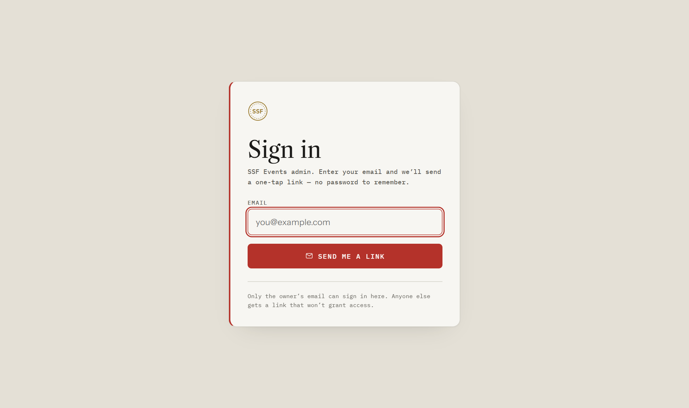
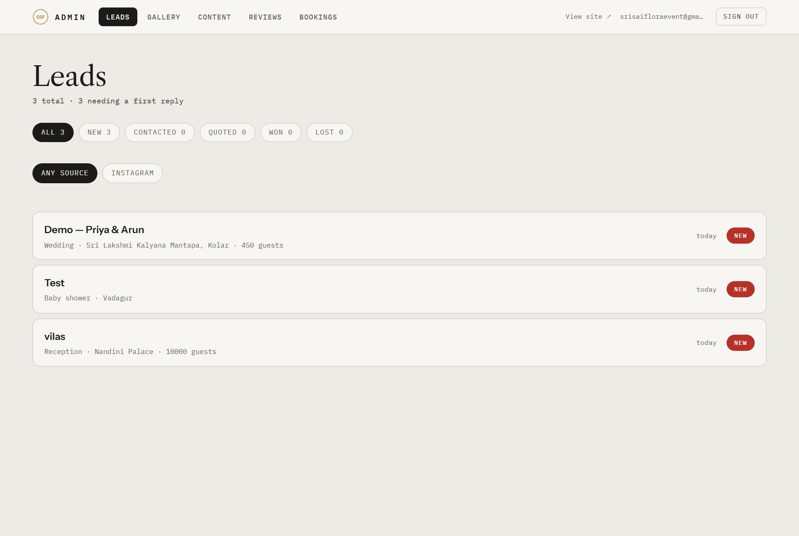
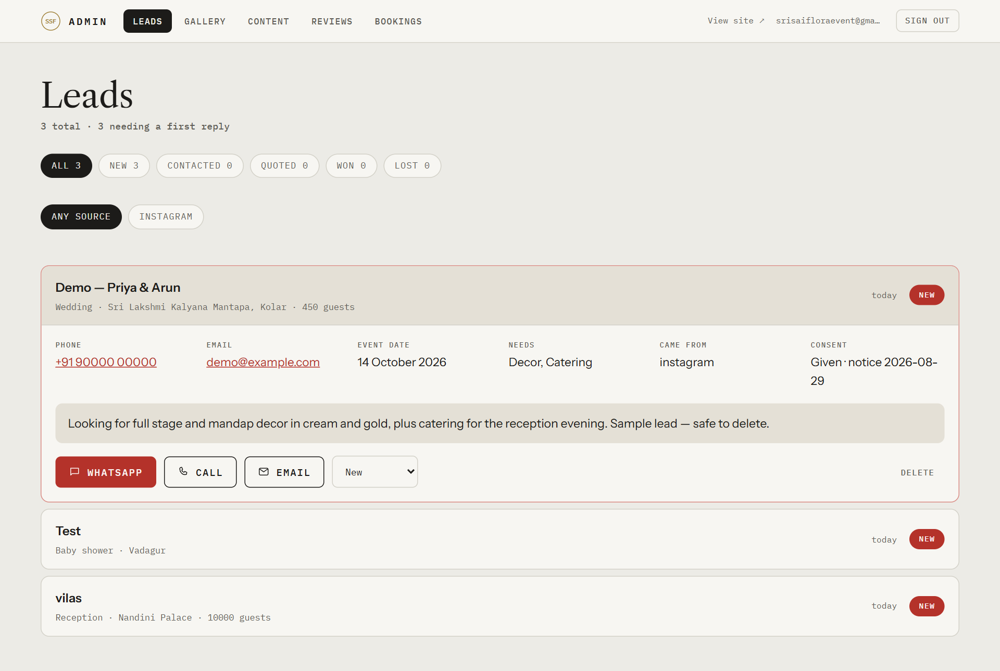
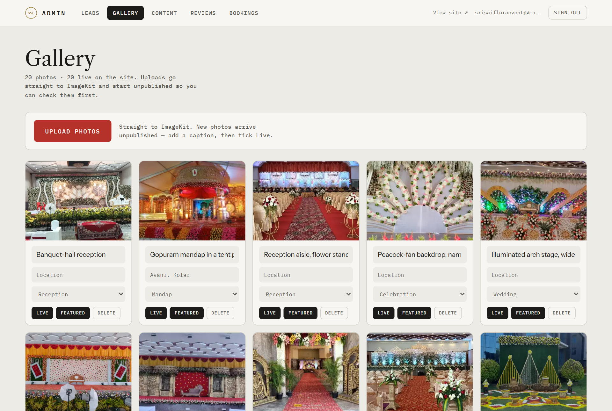
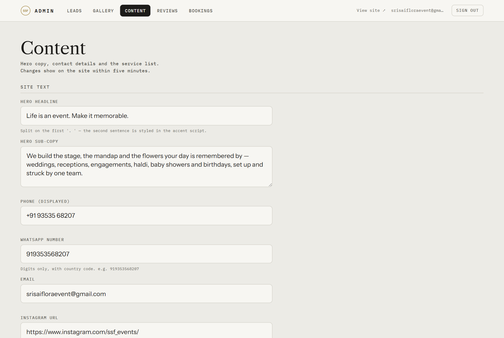
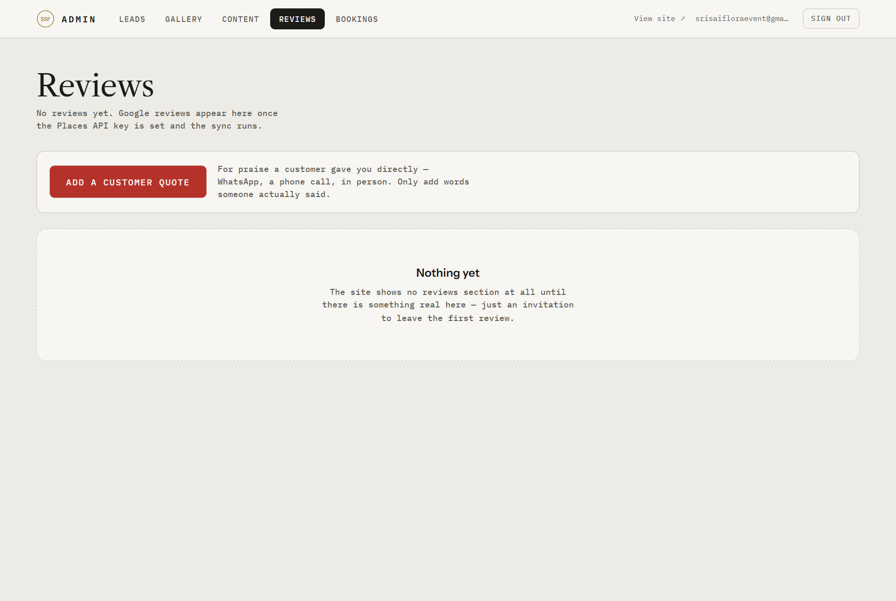
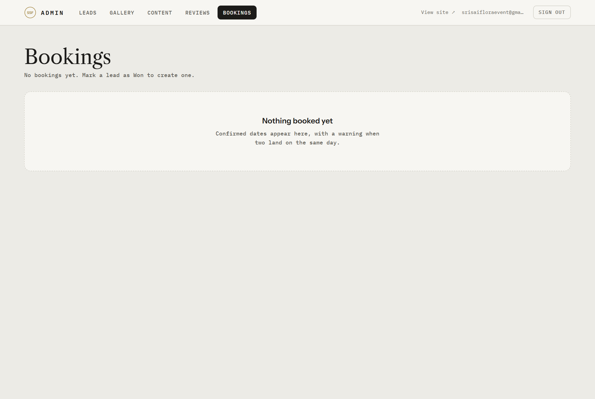

# SSF Events — admin guide

Everything on the website can be changed from one place: **the admin**. No code,
no developer, no waiting.

- **Website:** <https://ssf-events.vercel.app>
- **Admin:** <https://ssf-events.vercel.app/admin>
- **Who can sign in:** only `srisaifloraevent@gmail.com`

Changes you make show up on the website **within five minutes**.

---

## Signing in

There is no password. You type your email, we send you a link, you tap it.

1. Go to <https://ssf-events.vercel.app/admin>
2. Type **srisaifloraevent@gmail.com** and press **Send me a link**
3. Open the email and tap the link — it opens the dashboard

**You only do this once per device.** After that you stay signed in, so you can
bookmark the admin address and just open it. You will need a new link only if you
press *Sign out*, use a different phone or computer, or clear your browser data.

If the email is slow, check spam. Nobody else can get in even if they request a
link — they will be signed in but shown a "not an admin" screen with nothing
behind it.

---

## Leads — the enquiry inbox

This is the first page you see, and the one that matters most. Every enquiry from
the website lands here immediately.

At the top it tells you how many enquiries you have and **how many still need a
first reply**. The row of buttons filters the list:

| Filter | Meaning |
|---|---|
| **New** | Just arrived — nobody has replied yet |
| **Contacted** | You have spoken to them |
| **Quoted** | You have sent a price |
| **Won** | They booked you |
| **Lost** | They went elsewhere |

Below that, a second row lets you filter by where the enquiry came from —
Instagram, Google, and so on — so you can see which channel is actually bringing
work in.

### Opening an enquiry

Tap any row to open it.

You get everything the customer typed: phone, email, event date, venue, guest
count, what they need (decor, catering, DJ and lighting), where they came from,
and their message.

Then four things you can do:

- **WhatsApp** — opens WhatsApp with a message already written, addressed to them
  by name and referring to their function. Just add to it and send.
- **Call** — dials their number.
- **Email** — opens a reply, if they gave an email address.
- **Status dropdown** — move them along: New → Contacted → Quoted → Won or Lost.

Keeping the status up to date is what makes the filters and the "needs a first
reply" count useful. If an enquiry sits on **New** for more than two days it gets
a **needs reply** flag, so nothing quietly goes cold.

**Delete** removes the enquiry permanently. Use it for spam and wrong numbers.

---

## Gallery — the photos on the website

**To add photos:** press **Upload photos** and pick them — several at once is
fine. They upload straight to our image service, which resizes them for phones
automatically, so you can upload straight from your camera roll without worrying
about file size.

New photos arrive as **Draft** — not visible on the website yet. That is on
purpose: add a caption first, then publish.

For each photo you can set:

- **Caption** — what shows over the photo, e.g. "Reception aisle, flower stands"
- **Location** — e.g. "Kolar" or "CMR, Bengaluru"
- **Category** — Wedding, Reception, Mandap, Haldi, Celebration or Decor. This is
  what the filter buttons on the website use.

And three buttons:

- **Live / Draft** — whether it appears on the website
- **Featured** — mark your best work
- **Delete** — removes it from the website **and** from storage. Permanent.

Captions and locations save on their own the moment you click away from the box.

---

## Content — the words and your contact details

**Site text** — the headline and the paragraph under it on the front page, plus
your **phone, WhatsApp number, email, Instagram** and Google links.

Change your phone number here and it changes everywhere at once: the button at
the top of the site, the contact list, the WhatsApp button, and the privacy page.

> The WhatsApp number needs the country code — `919353568207`, not `9353568207`.

**Services** — the seven numbered cards on the front page. Rename them, rewrite
the descriptions, hide one with **Active/Hidden**, delete one, or add a new one at
the bottom. They appear on the website in the same order as here.

Everything saves as soon as you click away from a box.

---

## Reviews

The website **never shows a made-up review**. Until there is a real one, visitors
see a polite invitation to leave the first — with empty stars, so nothing looks
like a rating you have not earned.

**To add a review a customer gave you** — on WhatsApp, on the phone, or in person
— press **Add a customer quote** and enter their name, their star rating, and
their words.

> Only add words someone actually said. This is the whole point of the section.

Once reviews exist you can:

- **Live / Held** — show or hide any single review
- **Delete** — remove it

Google reviews can be pulled in automatically, but that needs a Google Cloud
billing account. Until then, adding them by hand here works exactly as well.

---

## Bookings

Confirmed jobs, with the enquiry they came from. If two bookings land on the same
day you get a warning on that date, so you notice a clash before it becomes a
problem on the morning.

---

## Everyday questions

**Someone enquired — where do I see it?**
Open the admin. It is at the top of the Leads list, marked **New**.

**Will I be told when an enquiry arrives?**
Not by email yet — that needs an email service key adding. For now, check the
admin, and note the customer is also sent to WhatsApp when they submit, so most
enquiries reach your phone anyway.

**Can I use this on my phone?**
Yes. The admin and the website both work on a phone.

**I changed something and the website looks the same.**
Wait up to five minutes and refresh. The website caches pages so it loads fast.

**Is customer data safe?**
Enquiries are only readable by you when signed in. The website collects nothing
except what the customer types into the form — no tracking, no IP addresses. This
is written out for customers on the privacy page, and required by law in India
(DPDP Act 2023).

**I want someone else to have access.**
Currently only one email can sign in. Ask your developer to add another address to
the admin allowlist.

---

## If something goes wrong

| Problem | What to do |
|---|---|
| Sign-in email does not arrive | Check spam. Wait a few minutes — there is an hourly limit on how many can be sent. |
| "That link has expired" | Links work once and last an hour. Ask for a fresh one. |
| Photo upload fails | Usually a very large file or a poor connection. Try one photo at a time. |
| "Not an admin" screen | You are signed in with the wrong email. Sign out and use `srisaifloraevent@gmail.com`. |
| Website is down | Check <https://vercel.com> for the hosting status. |
